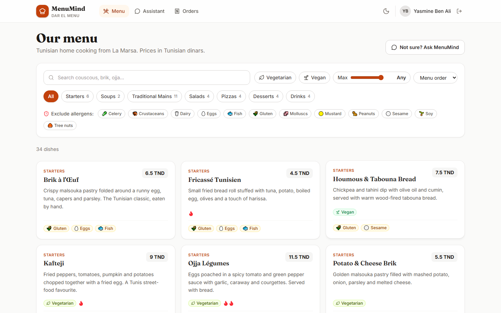
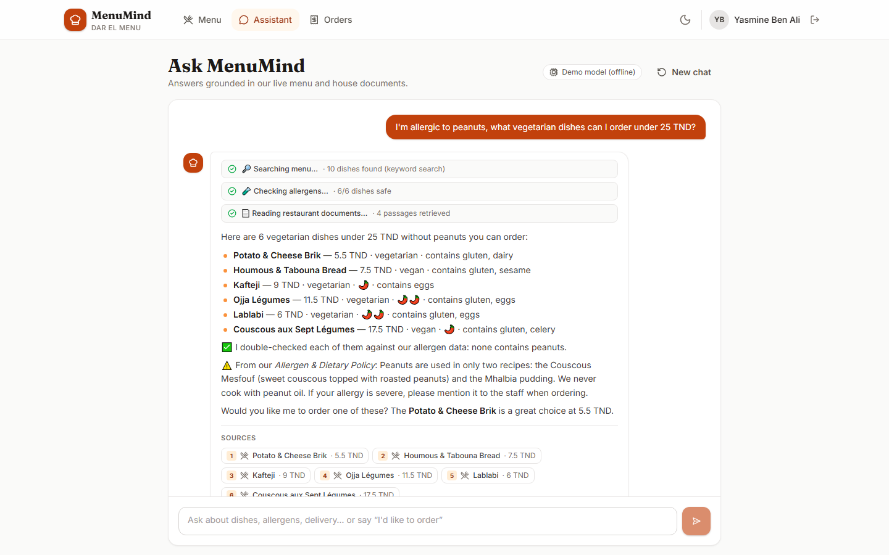
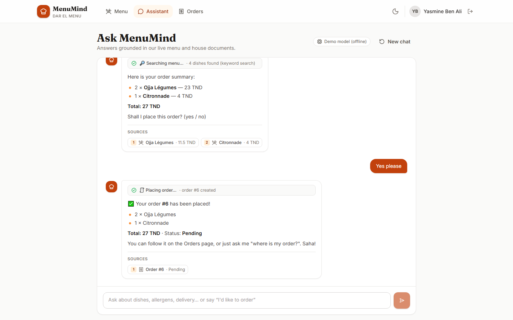
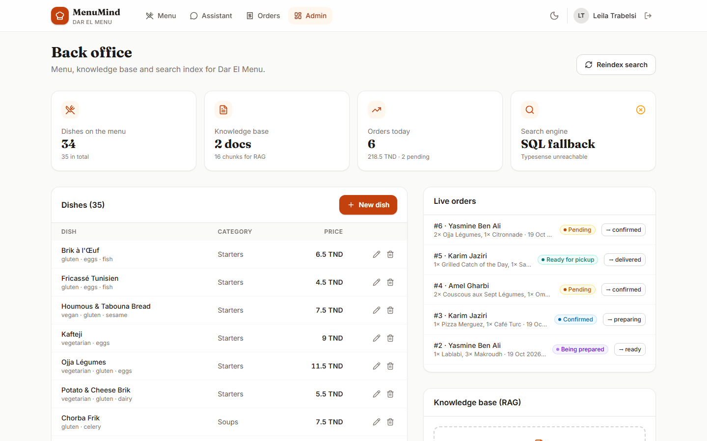
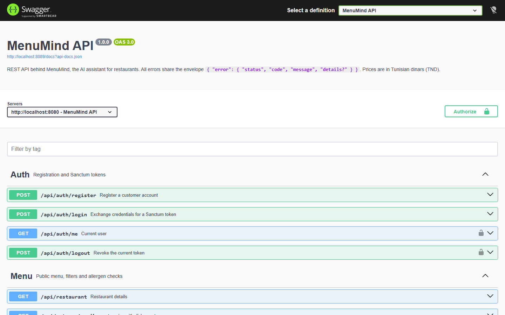
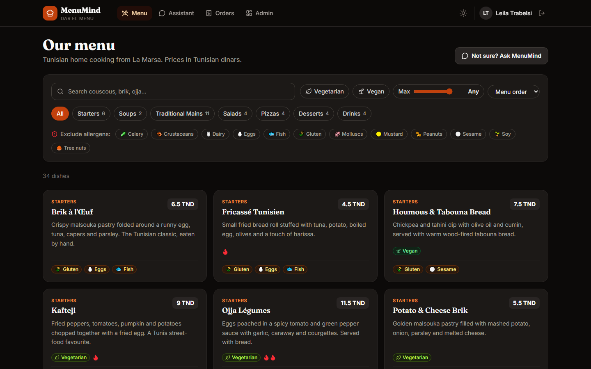
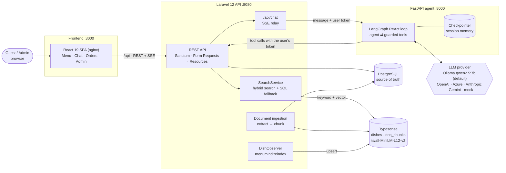
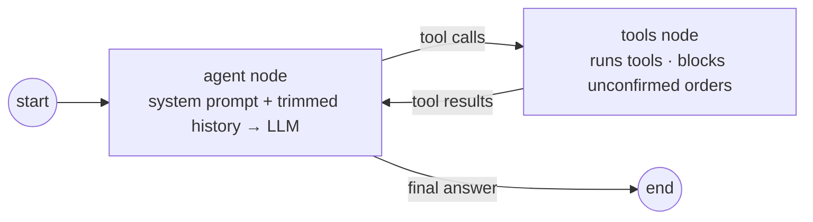

# MenuMind 🍽️

**An AI assistant for restaurants: guests ask in plain words, and a tool-using agent searches the real menu, checks allergens, answers from the house documents with citations, and places the order.**

[](https://github.com/YOUR_GITHUB_USERNAME/menumind/actions/workflows/ci.yml)


> ### 🆓 Runs 100% locally and free: no API key required
> `docker compose up --build` starts everything, including a local LLM (**Ollama + qwen2.5:7b**) and local embeddings (**Typesense's built-in `all-MiniLM-L12-v2`**). No data leaves your machine. Switching to OpenAI takes [two environment variables](#switching-to-openai-or-azure-openai).

The demo restaurant is **Dar El Menu**, a (fictional) Tunisian restaurant in La Marsa, with 35 dishes (couscous, brik, ojja, lablabi, mloukhia, makroudh…), 12 tracked allergens and two house documents: an allergen policy and an opening hours & delivery FAQ.

---

## Contents

[Screenshots](#screenshots) · [Features](#features) · [Architecture](#architecture) · [Tech stack](#tech-stack) · [RAG & hybrid search](#how-rag--hybrid-search-work) · [The agent](#how-the-agent-works) · [Quick start](#quick-start) · [Environment variables](#environment-variables) · [API](#api-overview) · [Tests](#running-tests) · [Project structure](#project-structure) · [Design decisions](#design-decisions--trade-offs) · [Roadmap](#roadmap)

## Screenshots

| Menu with filters and allergen badges | Assistant: tool steps, grounded answer, sources |
| :---: | :---: |
|  |  |
| **Ordering through the assistant (with confirmation)** | **Back office** |
|  |  |
| **Swagger / OpenAPI docs** | **Dark mode** |
|  |  |

<sub>Captured at 1440×900 with Playwright (`make screenshots`). These were taken on a machine without Docker, so they show the two fallback paths at work: the chat header says *Demo model (offline)* (the scripted model described below), and the admin card says *SQL fallback* because Typesense was not running. With the full `docker compose` stack the header shows `ollama · qwen2.5:7b` and the card shows *Hybrid*. More: [login](docs/screenshots/00-login.png), [orders](docs/screenshots/04-orders.png).</sub>

## Features

**For guests**
- 🔎 **Menu** with search, category chips, vegetarian/vegan toggles, a price slider and an **allergen exclusion** filter; every dish shows its allergen badges and spiciness.
- 💬 **Streaming chat assistant** that shows its work: each tool call appears live as a small step (*🔎 Searching menu… · 6 dishes found*), the answer streams token by token, and it ends with numbered **sources** (dishes link back to the menu, document passages show the quoted text).
- 🧪 **Allergy-aware recommendations**: allergies are excluded at search time and then double-checked dish by dish against the kitchen's allergen data.
- 📄 **Answers about the restaurant** (hours, delivery zones and fees, payment, cross-contamination policy) are retrieved from the uploaded documents and cited.
- 🧾 **Ordering in the chat**: the assistant shows a summary with the total and only places the order after an explicit "yes". Order status is available in the chat and on the Orders page.

**For the restaurant (admin)**
- Dashboard with menu, knowledge-base, orders and **search engine health** cards.
- Dish CRUD (allergens, diet flags, spiciness, availability), synced to the search index automatically.
- Knowledge-base upload (`.md`, `.txt`, `.pdf`, drag & drop): text extraction, chunking and indexing on upload.
- Live orders with one-click status transitions, plus a **Reindex** button.

**Engineering**
- REST API with Sanctum auth, roles, Form Request validation, API Resources, pagination, filtering and a **single JSON error envelope**.
- **Hybrid search** (keyword + vector) with Typesense, and graceful degradation to SQL when Typesense is down.
- **LangGraph agent** with five tools, per-session memory, provider-agnostic LLM layer and SSE streaming.
- OpenAPI docs (Swagger UI), 123 automated tests across the three services, GitHub Actions CI, Docker Compose, Makefile.

## Architecture



<sub>Also exported as [docs/architecture.png](docs/architecture.png) (`node frontend/scripts/render-diagram.mjs`).</sub>

**A chat turn, end to end:** the browser POSTs to `/api/chat` → Laravel authenticates the user and relays the message, the user's identity and **their own Sanctum token** to the agent → the LangGraph loop asks the LLM what to do → each tool is a REST call back into Laravel *as that user* → Laravel answers from PostgreSQL and Typesense → the agent streams steps, tokens and citations back as Server-Sent Events, which Laravel pipes straight to the browser.

## Tech stack

| Layer | Technologies |
| --- | --- |
| API | PHP 8.3, **Laravel 12**, Sanctum, Eloquent, Form Requests, API Resources, l5-swagger (OpenAPI 3), smalot/pdfparser |
| Data | **PostgreSQL 16** (SQLite for fast local tests) |
| Search | **Typesense 28**: BM25 + vector **hybrid search**, built-in `ts/all-MiniLM-L12-v2` embeddings |
| Agent | Python 3.12, **FastAPI**, **LangGraph**, LangChain core, httpx, Pydantic settings, uv |
| LLM | **Ollama (qwen2.5:7b)** by default; OpenAI, Azure OpenAI, Anthropic, Gemini, or a scripted mock |
| Frontend | **React 19**, TypeScript, Vite, **Tailwind CSS v4**, TanStack **React Query**, React Router, lucide icons |
| Quality | PHPUnit, Pytest (+ respx), Vitest + Testing Library, Ruff, oxlint, Playwright (screenshots) |
| Ops | Docker Compose (7 services, healthchecks), nginx, GitHub Actions, Makefile |

## How RAG & hybrid search work

**Ingestion (documents).** An admin uploads a `.md`, `.txt` or `.pdf` file. `TextExtractor` reads it (PDFs via `smalot/pdfparser`) and normalizes encoding and whitespace. `TextChunker` then splits it in a Markdown-aware way:
- each heading starts a new chunk and is kept as metadata, so a citation can say *Allergen & Dietary Policy › Peanuts and tree nuts*;
- paragraphs are packed up to ~700 characters, and oversized paragraphs are split on sentence boundaries;
- consecutive chunks share a short sentence overlap.

Chunks are stored in PostgreSQL (`document_chunks`), then pushed to the Typesense `doc_chunks` collection.

**Embeddings without an API.** Both collections declare an auto-embedding field:

```php
['name' => 'embedding', 'type' => 'float[]',
 'embed' => ['from' => ['name', 'description', 'category'],
             'model_config' => ['model_name' => 'ts/all-MiniLM-L12-v2']]]
```

Typesense computes the vectors itself, both at index time and for each query, so there is no embedding service to run or pay for.

**Hybrid query.** A search sends `query_by=name,description,category,embedding` with `vector_query=embedding:([], alpha: 0.4)`. Typesense runs keyword search and nearest-neighbour search in one request and fuses the two rankings (rank fusion, 40% weight on the semantic side). A vague request like *"something comforting without meat"* can then match dishes by meaning, while exact dish names still benefit from keyword matching.

**Structured filters in the same query.** Dish searches also carry a `filter_by` built from the same `DishFilters` value object that the SQL repository uses, so the menu page and the assistant apply identical rules:

```
restaurant_id:=1 && available:=true && price:<=25 && is_vegetarian:=true && allergens:!=[`peanuts`]
```

Free-text allergies are normalized first (`peanut` → `peanuts`, `milk` → `dairy`, `nuts` → `tree-nuts` + `peanuts`).

**Sync.** `DishObserver` upserts or deletes a dish in Typesense after every committed write. `php artisan menumind:reindex` (or the admin button) rebuilds both collections from SQL at any time.

**Graceful degradation.** If Typesense is unreachable, `SearchService` falls back to an in-database keyword scorer with the same filters. The response says which engine answered (`typesense_hybrid` or `sql_keyword`), and the admin dashboard surfaces it.

**Grounding.** The agent only sees what the tools return. Citations are built from the tools' raw results (not from the LLM's text) and filtered to the dishes the answer actually mentions.

## How the agent works



A LangGraph `StateGraph` with two nodes: the **agent** node calls the LLM (with the tools bound), and the **tools** node executes the requested calls and feeds the results back, until the model answers without calling a tool. Conversation memory is a LangGraph checkpointer keyed by session id (namespaced by user id, so a session can't be hijacked).

| Tool | Calls | Purpose |
| --- | --- | --- |
| `search_menu(query, filters)` | `GET /api/search/dishes` | Hybrid dish search with diet, budget, allergen, spiciness and category filters |
| `check_allergens(dish_ids, allergens)` | `POST /api/dishes/allergen-check` | Per-dish verdict against the guest's allergies |
| `search_docs(query)` | `GET /api/search/docs` | RAG over the restaurant's documents |
| `create_order(items, notes, confirmed)` | `POST /api/orders` | Places the order; totals are always computed server-side |
| `get_order_status(order_id?)` | `GET /api/orders/{id}` | Status of a given order, or of the guest's latest one |

**Safety lives in code, not only in the prompt:**
- The system prompt tells the model to ground every fact in tool results and never invent dishes or prices.
- `create_order` is **intercepted by the tools node**: unless the guest's latest message is an explicit confirmation of a summary the assistant asked about, the API is never called and the model receives `confirmation_required` instead.
- Tool errors (for example an order that belongs to someone else) come back to the model as structured errors instead of crashing the turn.

**The showcase question,** *"I'm allergic to peanuts, what vegetarian dishes can I order under 25 TND?"*, is answered in three tool calls in the screenshot above: `search_menu` with `{vegetarian: true, max_price: 25, exclude_allergens: ["peanuts"]}`, then `check_allergens` on the candidates, then `search_docs` for the cross-contamination policy. The answer lists the safe dishes, quotes the policy ("we never cook with peanut oil") and cites every source. A real LLM decides its own sequence, but the system prompt asks for this exact pattern whenever an allergy is mentioned.

**Streaming protocol** (`POST /api/chat`, `text/event-stream`):

| Event | Payload |
| --- | --- |
| `meta` | provider, model, fallback reason |
| `step` | `{tool, label, status: running \| done, summary}`, e.g. *🧪 Checking allergens… · 6/6 dishes safe* |
| `token` | a chunk of the answer |
| `citations` | dishes, document passages and orders the answer relied on |
| `reset` | the model timed out mid-answer: drop the partial text, the fallback model finishes the turn |
| `done` / `error` | end of turn |

**Provider-agnostic.** `create_chat_model()` returns a LangChain chat model for `ollama`, `openai`, `azure_openai`, `anthropic`, `gemini` or `mock`, chosen by `LLM_PROVIDER`. The default is Ollama with **qwen2.5:7b** (good tool calling for its size); on low-RAM machines use **llama3.2:3b**.

**The scripted `mock` model** is a deterministic stand-in that speaks the same tool-calling protocol: it emits real tool calls, the graph executes them against the live API, and it writes its answer only from the tool results. It powers offline demos and screenshots. The agent also falls back to it automatically when the configured provider is unusable: Ollama down, model still being pulled, API key missing, or a turn that times out or loses its connection halfway. In that last case the turn resumes from the LangGraph checkpoint, so tool calls already made are not repeated. The UI shows a *Demo model* badge when the fallback is active. Set `LLM_FALLBACK_TO_MOCK=false` to turn this off.

## Quick start

**Requirements:** Docker with Compose v2. About 8 GB of RAM for qwen2.5:7b (see below for smaller options).

```bash
git clone https://github.com/YOUR_GITHUB_USERNAME/menumind.git
cd menumind
docker compose up --build        # or: make up
```

| What | URL |
| --- | --- |
| App | http://localhost:3000 |
| API + Swagger UI | http://localhost:8080/api/documentation |
| Agent health | http://localhost:8000/health |

Log in as the customer **`demo@menumind.tn` / `password`**, or as the admin **`admin@menumind.tn` / `password`**.

On first start:
1. The backend migrates and seeds PostgreSQL (only when the database is empty), then indexes Typesense in the background. Typesense downloads its embedding model once.
2. The `ollama-init` job pulls `qwen2.5:7b` (~4.7 GB) into a volume. **Until it finishes, the assistant answers with the scripted model**, so the app is usable immediately.

Variants:

```bash
OLLAMA_MODEL=llama3.2:3b docker compose up --build   # low-RAM machines (~2 GB model)
LLM_PROVIDER=mock docker compose up --build          # no model at all (or: make up-mock)
```

Useful shortcuts: `make logs`, `make seed` (reset demo data), `make reindex`, `make test`, `make screenshots`, `make down`.

### Switching to OpenAI or Azure OpenAI

Create a `.env` next to `docker-compose.yml` (see [.env.example](.env.example)) and set **two variables**:

```dotenv
LLM_PROVIDER=openai
OPENAI_API_KEY=sk-...
```

Azure OpenAI uses the same pattern. Besides the key you also give it your resource's endpoint and deployment name:

```dotenv
LLM_PROVIDER=azure_openai
AZURE_OPENAI_API_KEY=...
AZURE_OPENAI_ENDPOINT=https://<resource>.openai.azure.com
AZURE_OPENAI_DEPLOYMENT=gpt-4o-mini
```

`anthropic` (with `ANTHROPIC_API_KEY`) and `gemini` (with `GOOGLE_API_KEY`) work the same way. Then run `docker compose up -d agent` to restart the agent. Nothing else changes: same tools, graph, guards and UI.

### Running without Docker

```bash
# API (SQLite, no Typesense: search uses the SQL fallback)
cd backend && composer install && cp .env.example .env && php artisan key:generate
# in .env: DB_CONNECTION=sqlite, TYPESENSE_ENABLED=false
touch database/database.sqlite && php artisan migrate --seed && php artisan serve --port=8080

# Agent
cd agent && uv sync && LLM_PROVIDER=mock uv run uvicorn menumind_agent.main:app --port 8000

# Frontend (proxies /api to :8080)
cd frontend && npm install && npm run dev
```

The agent calls back into the API while a chat request is still open, so the API needs more than one worker. Docker sets `PHP_CLI_SERVER_WORKERS=8`. PHP's built-in server ignores that setting on Windows, so there you can start a second `php artisan serve --port=8081` and point the agent's `LARAVEL_API_URL` at it.

## Environment variables

Compose reads a root `.env` (all values have working defaults). Each service also has its own `.env.example` for running it standalone.

| Variable | Default | Used by | Description |
| --- | --- | --- | --- |
| `LLM_PROVIDER` | `ollama` | agent | `ollama`, `openai`, `azure_openai`, `anthropic`, `gemini` or `mock` |
| `LLM_MODEL` | – | agent | Overrides the provider's default model |
| `LLM_FALLBACK_TO_MOCK` | `true` | agent | Use the scripted model when the provider is unusable |
| `LLM_TIMEOUT_SECONDS` | `180` | agent | Max duration of one turn |
| `OLLAMA_MODEL` | `qwen2.5:7b` | agent, ollama-init | Model pulled and used (`llama3.2:3b` for low RAM) |
| `OPENAI_API_KEY` / `OPENAI_MODEL` | – / `gpt-4.1-mini` | agent | OpenAI |
| `AZURE_OPENAI_API_KEY`, `AZURE_OPENAI_ENDPOINT`, `AZURE_OPENAI_DEPLOYMENT` | – | agent | Azure OpenAI |
| `ANTHROPIC_API_KEY` / `GOOGLE_API_KEY` | – | agent | Anthropic / Gemini |
| `AGENT_SHARED_SECRET` | `menumind-local-secret` | backend, agent | The agent only accepts chat calls carrying this secret |
| `TYPESENSE_API_KEY` | `menumind-dev-key` | backend, typesense | Typesense admin key |
| `TYPESENSE_HYBRID_ALPHA` | `0.4` | backend | Weight of vector vs keyword ranking |
| `TYPESENSE_EMBEDDING_MODEL` | `ts/all-MiniLM-L12-v2` | backend | Built-in embedding model |
| `TYPESENSE_ENABLED` | `true` | backend | `false` forces the SQL fallback |
| `POSTGRES_PASSWORD` | `menumind` | postgres, backend | Database password |
| `APP_KEY` | generated | backend | Laravel key (generated at start-up when empty) |
| `APP_PORT` / `API_PORT` / `AGENT_PORT` | `3000` / `8080` / `8000` | compose | Host ports. PostgreSQL, Typesense and Ollama are not published, so they never clash with local installs. |

## API overview

Full, interactive reference: **Swagger UI at `/api/documentation`**. Errors always look like:

```json
{ "error": { "status": 422, "code": "validation_failed", "message": "The price field is required.", "details": { "price": ["The price field is required."] } } }
```

| Method & path | Auth | Description |
| --- | --- | --- |
| `POST /api/auth/register` · `POST /api/auth/login` | – | Create an account / get a Sanctum token |
| `GET /api/auth/me` · `POST /api/auth/logout` | user | Current user / revoke token |
| `GET /api/restaurant` · `/api/categories` · `/api/allergens` | – | Reference data |
| `GET /api/dishes` | – | Paginated menu. Filters: `search`, `category`, `min_price`, `max_price`, `vegetarian`, `vegan`, `max_spicy`, `exclude_allergens`, `sort` |
| `GET /api/dishes/{id}` | – | Dish details |
| `POST /api/dishes/allergen-check` | – | Check dishes against allergies |
| `GET /api/search/dishes?q=` | – | Hybrid search, same filters as `/dishes` |
| `GET /api/search/docs?q=` | – | Retrieve document chunks (RAG) |
| `GET /api/orders` · `POST /api/orders` · `GET /api/orders/{id}` | user | Order history / place / details (own orders; admins see all) |
| `POST /api/chat` | user | Talk to the assistant (SSE stream, or JSON with `stream=false`) |
| `POST /api/dishes` · `PATCH /api/dishes/{id}` · `DELETE /api/dishes/{id}` | admin | Menu management |
| `PATCH /api/orders/{id}/status` | admin | Move an order through `pending → confirmed → preparing → ready → delivered` (or `cancelled`) |
| `GET /api/documents` · `POST /api/documents` · `DELETE /api/documents/{id}` | admin | Knowledge base (upload: multipart `file`, optional `title`) |
| `GET /api/admin/stats` · `POST /api/admin/reindex` | admin | Dashboard numbers, search health / rebuild the index |

## Running tests

```bash
make test             # all three suites
make test-backend     # cd backend && php artisan test
make test-agent       # cd agent && uv run pytest
make test-frontend    # cd frontend && npm test
make lint             # ruff + oxlint + tsc
```

| Suite | Tests | Covers |
| --- | --- | --- |
| Backend (PHPUnit) | 57 | Auth, dish filtering and sorting, allergen check, admin CRUD, orders (totals, ownership, status transitions), validation and the error envelope, document upload and chunking, hybrid search (Typesense faked over HTTP) and its SQL fallback, chat proxy (JSON, SSE, agent down) |
| Agent (Pytest) | 45 | API client, every tool, the LangGraph loop with a scripted fake LLM, the order confirmation guard, session memory, provider selection and fallback (including a model that hangs or disconnects mid-turn), scripted model behaviour, `/chat` and `/chat/stream` endpoints. All LLM and HTTP calls are mocked. |
| Frontend (Vitest) | 21 | Dish card, filter bar, chat bubble (steps, markdown, citations), login flow, API client, SSE parser |

CI runs the backend suite against a real **PostgreSQL** service container, lints and tests the agent and the frontend, builds the frontend, and builds the three Docker images.

## Project structure

```
menumind/
├── backend/                     Laravel 12 REST API
│   ├── app/
│   │   ├── Console/Commands/    menumind:reindex, menumind:bootstrap
│   │   ├── Exceptions/          ApiException + JSON error envelope renderer
│   │   ├── Http/                Controllers/Api, Requests (validation), Resources, role middleware
│   │   ├── Models/ Enums/ Observers/ Policies/
│   │   ├── OpenApi/             OpenAPI spec (PHP attributes)
│   │   ├── Repositories/        DishRepository (contract + Eloquent implementation)
│   │   ├── Services/            Auth, Dish, Order, Chat/AgentClient,
│   │   │                        Documents/ (extract, chunk, ingest), Search/ (Typesense client, schemas, indexer, hybrid search)
│   │   └── Support/             DishFilters value object, AllergenResolver
│   ├── database/                migrations, factories, seeders (+ markdown knowledge base)
│   └── tests/                   Feature & Unit
├── agent/                       FastAPI + LangGraph service
│   ├── src/menumind_agent/      config, api_client, tools, graph, guards, llm, mock_llm,
│   │                            citations, prompts, service (JSON + SSE), main
│   └── tests/
├── frontend/                    React + Vite + TypeScript + Tailwind
│   ├── src/{components,context,hooks,lib,pages}
│   ├── scripts/                 Playwright screenshots, diagram rendering
│   └── docker/nginx.conf        SPA + /api reverse proxy (SSE-friendly)
├── docs/                        architecture diagram, screenshots
├── docker-compose.yml           postgres · typesense · ollama (+ init) · backend · agent · frontend
├── .github/workflows/ci.yml
└── Makefile
```

## Design decisions & trade-offs

- **Laravel 12 instead of 11.** I started on Laravel 11, but Composer now refuses every 11.x release because of published security advisories (11 is end-of-life). Laravel 12 has the same slim skeleton (`bootstrap/app.php`, no HTTP kernel) and still receives security fixes, so the design is unchanged.
- **The agent is just another API client.** It never touches the database. It calls the same REST endpoints as the SPA, with the end user's own token. Validation, pricing, ownership rules and rate limits live in one place, and the agent can never do more than the customer it is talking to.
- **Guardrails in code, not only in the prompt.** The order confirmation check runs in the tools node and totals are recomputed server-side, so a confused or prompt-injected model can't place an unconfirmed order or invent a price.
- **SQL is the source of truth; Typesense is a derived index.** Document chunks are stored in PostgreSQL too, so the index can be dropped and rebuilt at any time (`menumind:reindex`). Search degrades to SQL instead of failing, and says so.
- **Embeddings inside Typesense.** The built-in `all-MiniLM-L12-v2` model removes an embedding service, its API key and a network hop. The trade-off is a small English-centric model. A multilingual model, or OpenAI embeddings, is a one-line change in the collection schema.
- **One value object for filters.** `DishFilters` feeds both the SQL repository and the Typesense `filter_by` builder, so the menu page and the assistant can't disagree about what "vegetarian under 25 TND without peanuts" means.
- **A scripted model that follows the real protocol.** Rather than a canned-answer mock, the fallback model emits tool calls that run against the real API. Demos, screenshots and CI-style smoke tests stay deterministic and free while still exercising the whole pipeline.
- **SSE relayed through Laravel.** Streaming is one-way, so Server-Sent Events are enough (no WebSocket server). Relaying through `/api/chat` keeps one origin, one auth system and lets nginx stream with `proxy_buffering off`.
- **`php artisan serve` with 8 workers instead of php-fpm.** It is fewer moving parts for a demo stack. It is not a production server; Octane/FrankenPHP or FPM is on the roadmap.
- **In-memory conversation memory.** LangGraph's `InMemorySaver` is simple and fast but resets when the agent restarts. Moving to the Postgres checkpointer is a constructor change.
- **Single restaurant, multi-tenant-ready schema.** Every table carries `restaurant_id` and the code goes through `Restaurant::current()`, so tenancy becomes a routing and scoping concern later rather than a migration.
- **Money as `decimal(8,3)`.** The Tunisian dinar has 1000 millimes. Order lines snapshot the dish name and unit price, so later menu edits never rewrite past orders.
- **Repository only where it pays off.** Dish querying is shared by the listing, the search fallback and the indexer, so it has a repository contract. Other aggregates use services directly.

## Roadmap

- [ ] **Dify integration**: expose MenuMind's tools as a Dify custom tool (OpenAPI) so non-developers can iterate on prompts and flows, and compare it with the LangGraph agent.
- [ ] **Azure deployment**: Azure Container Apps + Azure Database for PostgreSQL + Azure OpenAI, with Bicep and a GitHub Actions deploy job.
- [ ] **Multi-restaurant tenancy**: subdomain-based tenant resolution, per-tenant Typesense scoped API keys, per-tenant branding and documents.
- [ ] Persistent agent memory (Postgres checkpointer) and tracing (LangSmith / OpenTelemetry).
- [ ] An evaluation set for the agent (grounding and refusal checks with an LLM judge), run in CI.
- [ ] Multilingual UI (French / Arabic) and a multilingual embedding model.
- [ ] Production web server (Octane / FrankenPHP), queued indexing and real-time order updates for a kitchen display.
- [ ] WhatsApp and voice ordering channels.

## Author

**[Your Name]**: [LinkedIn](https://www.linkedin.com/in/your-profile) · [your.email@example.com](mailto:your.email@example.com)

If you have feedback or questions about this project, I'd be glad to hear from you.
